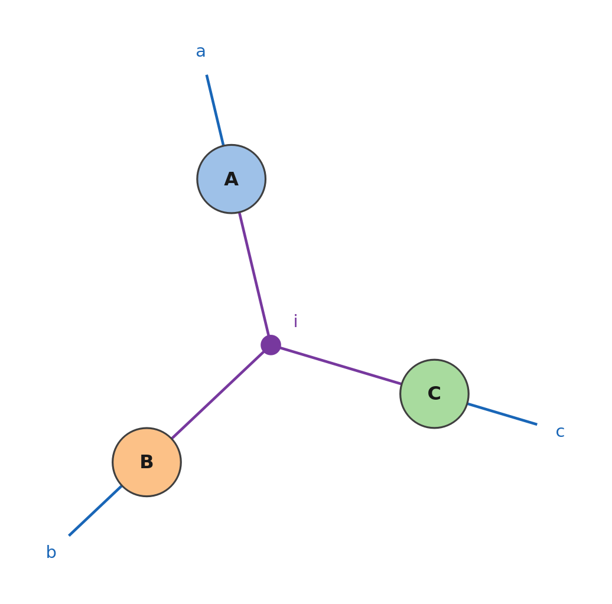
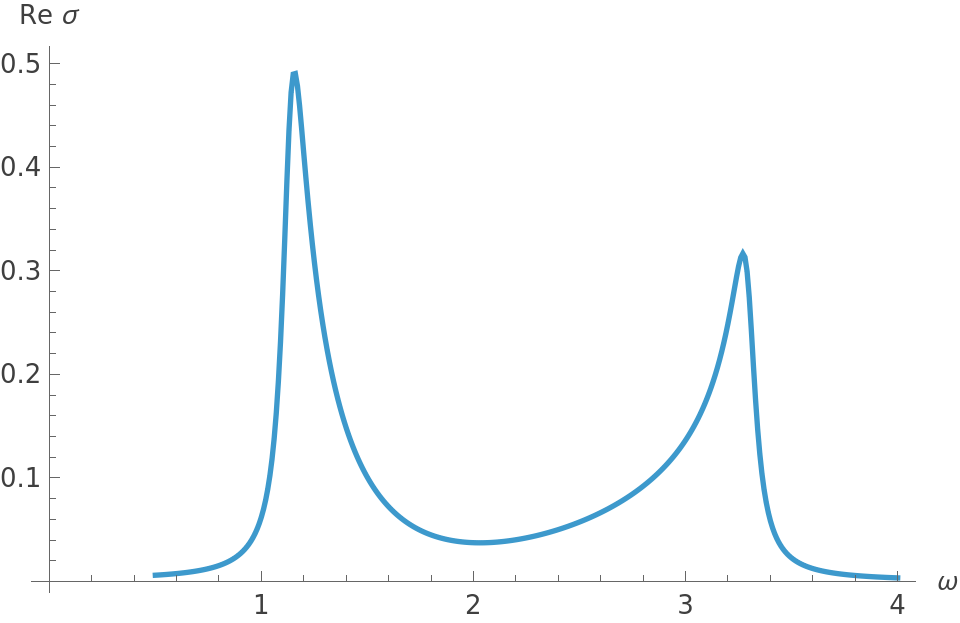
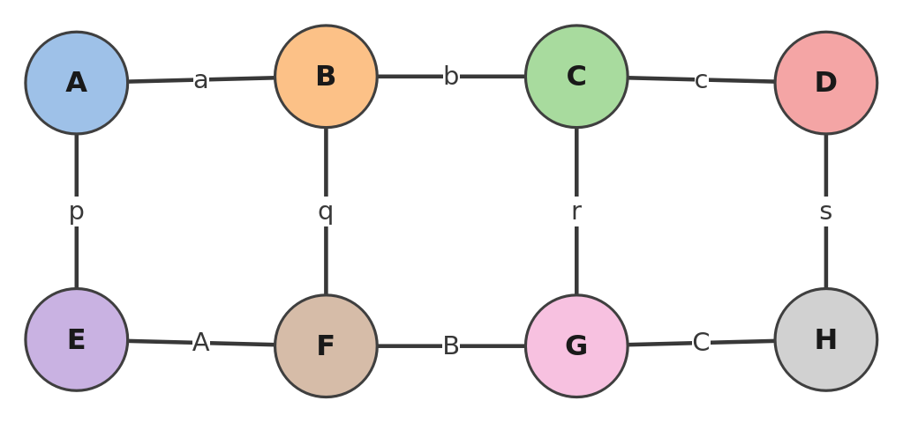
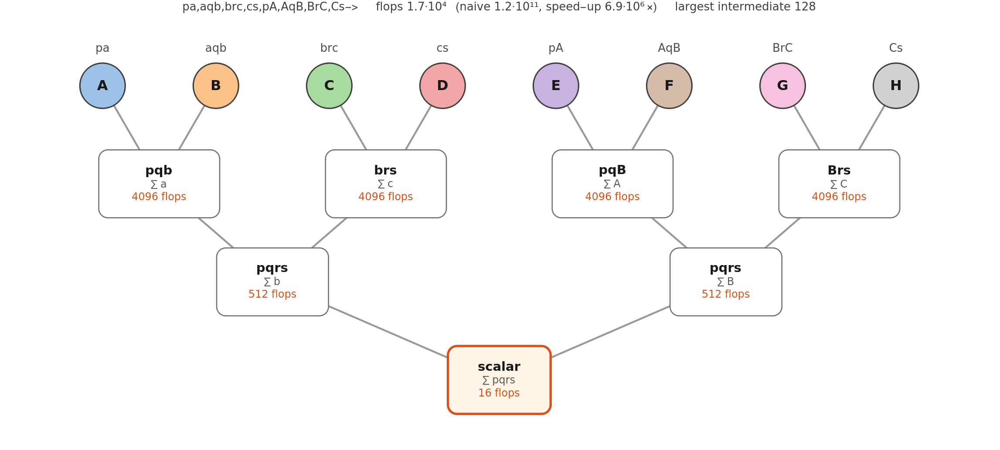

<p align="center">
  
</p>

<h1 align="center">Summa</h1>

<p align="center">
  <b>Fast Einstein summation for the Wolfram Language</b><br>
  the syntax of numpy.einsum, indices repeated at will, optimal contraction orders, tensor-network diagrams
</p>

<p align="center">
  <a href="https://github.com/n4sd4q/Summa/releases/latest"></a>
  
  <a href="Tests"></a>
  
</p>

<p align="center">
  <a href="https://n4sd4q.github.io/Summa/"><b>Website</b></a>&nbsp;·
  <a href="https://n4sd4q.github.io/Summa/Showcase/Summa_Showcase.pdf"><b>Showcase</b></a>&nbsp;·
  <a href="https://n4sd4q.github.io/Summa/Documentation/Summa_Manual.pdf"><b>Manual</b></a>&nbsp;·
  <a href="Examples.wl"><b>Guided&nbsp;tour</b></a>&nbsp;·
  <a href="https://github.com/n4sd4q/Summa/wiki"><b>Wiki</b></a>&nbsp;·
  <a href="#installation"><b>Installation</b></a>
</p>

Summa contracts tensors with the syntax of `numpy.einsum`: you write a contraction as on paper, the indices of every
factor, `"ij,jk->ik"`, and Summa works out how to compute it — the cheapest order of the pairwise contractions and the
kernel of each, BLAS or vectorised, with no transposes, reshapes or intermediate arrays by hand. An index may appear in
any number of tensors — diagonals, traces, hyperedges, batch indices — and the network can be drawn as it is computed.

## What it does

- **Written as on paper, computed for you.** The string syntax of numpy, `"ij,jk->ik"`, with implicit output, ellipsis
  and broadcasting, Unicode labels, or lists of labels of any kind; how to compute it is Summa's job.
- **Indices repeated at will.** Diagonals, traces and sums, and an index shared by three or more tensors (hyperedges, batch
  indices) in a single call.
- **The cheapest order.** The order of the pairwise contractions minimises the flops (an exact search up to eight tensors,
  greedy beyond); `EinsumPath` gives its cost and its speed-up over the naive sum.
- **Fast kernels.** Each contraction runs on BLAS `Dot`, on batched kernels or on broadcasting, with as few transposes as
  possible; plans are cached, and `EinsumFunction` precompiles an einsum for loops.
- **The network, drawn.** `EinsumDiagram` draws the tensor network — bonds, open legs, traces, hyperedges, the order of
  the contractions — and `EinsumTree` the contraction tree with the cost of every step.
- **Any entries.** Machine numbers, exact and symbolic entries, complex numbers, `SparseArray`.

Every result is checked against `numpy.einsum`, and the optimal order against an exhaustive search of all orders.

<details>
<summary>Everything it does, with the names of the functions</summary>

- `Einsum[spec, t1, t2, ...]`, with `spec` a numpy string (`"ij,jk->ik"`, `"...ij,...jk->...ik"`) or a rule of lists of
  labels (`{{i, j}, {j, k}} -> {i, k}`); options `"Path"` (`Automatic`, `"Optimal"`, `"Greedy"`, `"Sequential"` or a list of
  pairs), `"BatchMethod"` (`Automatic`, `"Dot"`, `"Vectorized"`), `"Cache"`
- `EinsumPath[spec, t1, ...]` or `EinsumPath[spec, {dims1, ...}]`: the order of the contractions, its flops, the naive flops,
  the speed-up and the largest intermediate
- `EinsumFunction[spec, {dims1, ...}]`: a precompiled einsum for fixed shapes, with the properties `"Path"`, `"Flops"`,
  `"Speedup"`, `"Diagram"`, `"Tree"`, ...
- `EinsumDiagram[spec]`, `EinsumDiagram[spec, t1, ...]`: the tensor network; options `"ShowPath"`, `"Steps"`, `"Layout"`,
  `"TensorNames"`, `"Highlight"`, `"ShowDimensions"`
- `EinsumTree[spec, t1, ...]`: the contraction tree, with the indices and the flops of every intermediate
- `EinsumClearCache[]`; `$SummaVersion`, `SummaUpdateCheck[]`, `$SummaUpdateCheck`

</details>

## A first example

One session, from a trace to a tensor network:

```mathematica
Needs["Summa`"]
```

**Indices as on paper.** A repeated index is summed: the trace of a matrix, and its square.

```mathematica
m = {{a, b}, {c, d}};
{Einsum["ii", m], Einsum["ij,jk->ik", m, m]}
```

```math
\left\{a+d,\left(
\begin{array}{cc}
 a^2+b c & a b+b d \\
 a c+c d & b c+d^2 \\
\end{array}
\right)\right\}
```

**An index in any number of tensors.** `ResourceFunction["EinsteinSummation"]` refuses an index that appears three
times, and `TensorContract` sums one only after building the whole outer product. In Summa an index may appear in any
number of tensors: here `i` is shared by three vectors, $\sum_i x_iy_iz_i$:

```mathematica
Einsum["i,i,i->", {a, b}, {c, d}, {e, f}]
```

$$a c e+b d f$$

and in `"ai,bi,ci->abc"` by three matrices, the reconstruction of a tensor from its canonical decomposition: a hyperedge,
drawn by `EinsumDiagram`.

```mathematica
EinsumDiagram["ai,bi,ci->abc"]
```

<p align="center">abc: three tensors A, B, C, each with an open leg a, b, c, joined by the hyperedge i, drawn as a purple dot"></p>

**A Kubo formula, as it is written.** The optical conductivity of a two-band chain,
$\sigma(\omega)=\frac{i}{N}\sum_k\sum_{nm}J_{nm}(k)J_{mn}(k)F_{nm}(k,\omega)$, in which $k$, $n$ and $m$ each appear in
three tensors: one einsum, with no loop and no intermediate array written by hand.

```mathematica
h[k_] := (1 + 0.6 Cos[k]) PauliMatrix[1] + 0.6 Sin[k] PauliMatrix[2] + 0.4 PauliMatrix[3];   (* the Rice-Mele chain *)
ks = Most[Subdivide[-Pi, Pi, 400]]; ws = Subdivide[0.5, 4., 350];
{e, u} = Transpose[Eigensystem /@ (h /@ ks)];
current = MapThread[Conjugate[#1] . (D[h[q], q] /. q -> #2) . Transpose[#1] &, {u, ks}];
f = UnitStep[-e];   (* half filling *)
weight = Table[If[n == m, 0, (f[[q, n]] - f[[q, m]])/(e[[q, m]] - e[[q, n]])/(w - e[[q, m]] + e[[q, n]] + 0.05 I)],
   {q, 400}, {n, 2}, {m, 2}, {w, ws}];
sigma = I/400 Einsum["knm,kmn,knmw->w", current, current, weight];
ListLinePlot[Transpose[{ws, Re[sigma]}], AxesLabel -> {"\[Omega]", "Re \[Sigma]"}]
```

<p align="center"></p>

**A tensor network.** The norm of a matrix-product state of four sites, the state above and its conjugate below:

```mathematica
mps = "pa,aqb,brc,cs,pA,AqB,BrC,Cs->";
EinsumDiagram[mps]
```

<p align="center"></p>

**The order matters.** With bonds of dimension 32, the order that Summa chooses costs $1.7\cdot10^4$ flops, the naive sum
$1.2\cdot10^{11}$:

```mathematica
dims = {{2, 32}, {32, 2, 32}, {32, 2, 32}, {32, 2}, {2, 32}, {32, 2, 32}, {32, 2, 32}, {32, 2}};
Lookup[EinsumPath[mps, dims], {"Flops", "NaiveFlops", "Speedup"}]
```

$$\\{17424.,1.20259\times 10^{11},6.90192\times 10^6\\}$$

```mathematica
EinsumTree[mps, dims]
```

<p align="center"></p>

**Fast in loops.** `EinsumFunction` plans once for fixed shapes: here a thousand products of 4×4 matrices, a batched
kernel instead of a thousand calls to `Dot`.

```mathematica
SeedRandom[1]; {x, y} = RandomReal[1, {2, 1000, 4, 4}];
batch = EinsumFunction["bij,bjk->bik", {{1000, 4, 4}, {1000, 4, 4}}];
batch[x, y] == MapThread[Dot, {x, y}]
```

```text
True
```

**Next.** The [guided tour](Examples.wl) goes through the syntax, repeated indices, orders and kernels step by step; the
[wiki](https://github.com/n4sd4q/Summa/wiki) has the recipes; the
[showcase](https://n4sd4q.github.io/Summa/Showcase/Summa_Showcase.pdf) shows what the package can do and the
[manual](https://n4sd4q.github.io/Summa/Documentation/Summa_Manual.pdf) describes every function. ``?Summa`*`` lists the
functions and `?Name` explains each one.

## Installation

Install the paclet of the latest [release](https://github.com/n4sd4q/Summa/releases) once:

```mathematica
PacletInstall["https://github.com/n4sd4q/Summa/releases/download/v1.0.0/Summa-1.0.0.paclet"]
```

and load it in every session:

```mathematica
Needs["Summa`"]
```

There are no dependencies; the package needs Mathematica 11.3 or later. The guided tour, a notebook to run cell by cell,
comes with the paclet:

```mathematica
NotebookOpen[PacletObject["Summa"]["AssetLocation", "Examples"]]
```

In a notebook the package looks for a newer release on GitHub once a day; `$SummaUpdateCheck = False` before `Needs` turns
this off ([`SECURITY.md`](SECURITY.md) says more). Other ways to install, and updating: the wiki's
[Installation](https://github.com/n4sd4q/Summa/wiki/Installation) page.

## Documentation

| Document | Contents |
|---|---|
| [Website](https://n4sd4q.github.io/Summa/) | the package at a glance: what it does, the first example, installation, the documents |
| [Guided tour](Examples.wl) | a notebook to run cell by cell, from a trace to tensor networks (`Summa/Examples.nb` in the paclet) |
| [Wiki](https://github.com/n4sd4q/Summa/wiki) | practical guides: the syntax, repeated indices, orders and costs, speed, the diagrams; a FAQ |
| [Showcase](https://n4sd4q.github.io/Summa/Showcase/Summa_Showcase.pdf) (PDF) | the package step by step, from the syntax to tensor networks, with the cost of every order |
| [Manual](https://n4sd4q.github.io/Summa/Documentation/Summa_Manual.pdf) (PDF) | every function, option and message, the conventions and the limits |
| [Changelog](CHANGELOG.md) | what changed in each version |

Every output printed in the documents is computed by the code shown before it.

## Checks

The tests (`wolfram -script Tests/RunTests.wls`, 735 tests) compare `Einsum` with `numpy.einsum` on 213 contractions
computed in exact integer arithmetic, every one with every order and every kernel, and with an explicit sum in machine
precision, real and complex; the optimal order must cost as little as an exhaustive search of all orders on 40 networks.
`sh Development/check_docs.sh` runs the code of the showcase, the manual, the guided tour, the README and the wiki again,
in fresh kernels, and compares it with what they print.

## Related software

[`numpy.einsum`](https://numpy.org/doc/stable/reference/generated/numpy.einsum.html) defines the syntax, and
[opt_einsum](https://github.com/dgasmith/opt_einsum) the search of the contraction order;
[TensorOperations.jl](https://github.com/Jutho/TensorOperations.jl) (Julia) and
[cotengra](https://github.com/jcmgray/cotengra) (Python, large networks) do the same in other languages. In Mathematica,
`TensorContract` and `ResourceFunction["EinsteinSummation"]` contract pairs of indices. Summa brings the syntax of numpy to the
Wolfram Language with indices shared by any number of tensors, the optimal order, BLAS and batched kernels, and the drawing
of the network.

## Citing

If you use Summa in published work, please cite it as described in [`CITATION.cff`](CITATION.cff).

## License

Released under the [GNU General Public License, version 3 or later](LICENSE), with two additional terms
([`NOTICE`](NOTICE)): the attribution to the author must be kept, and modified versions must say that they are modified,
by whom and when. Author: Nazzareno Africani (SISSA).