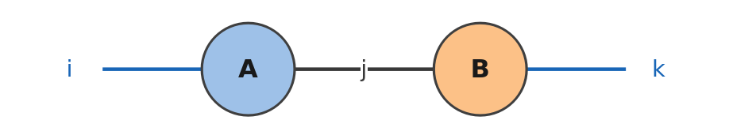
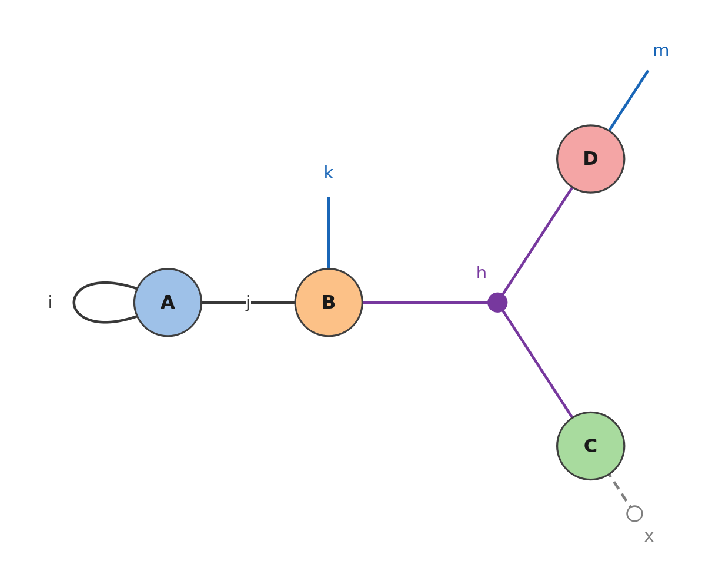
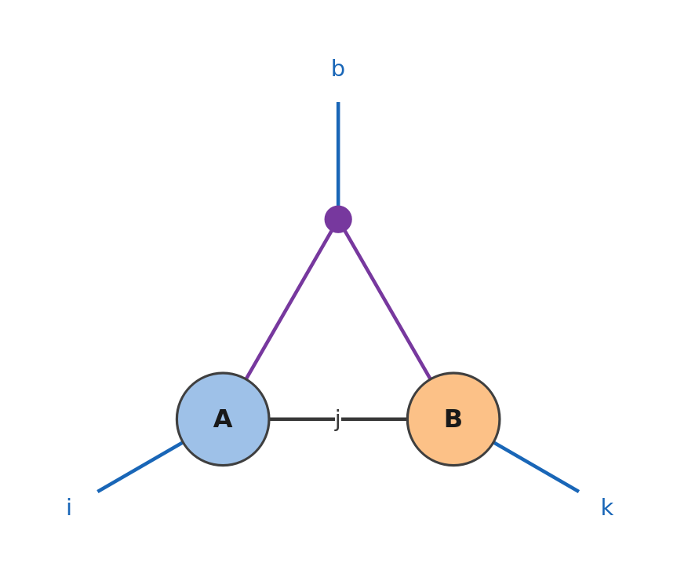
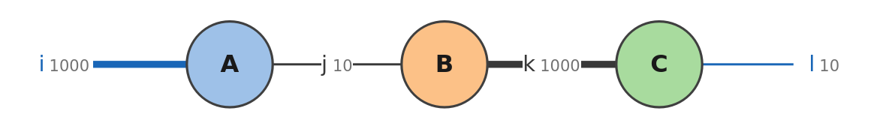
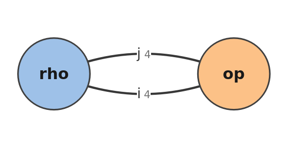
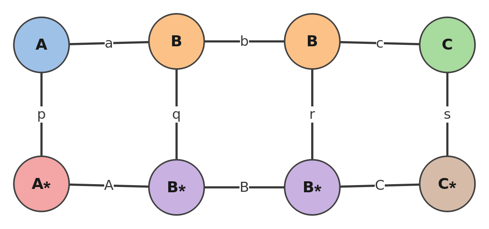
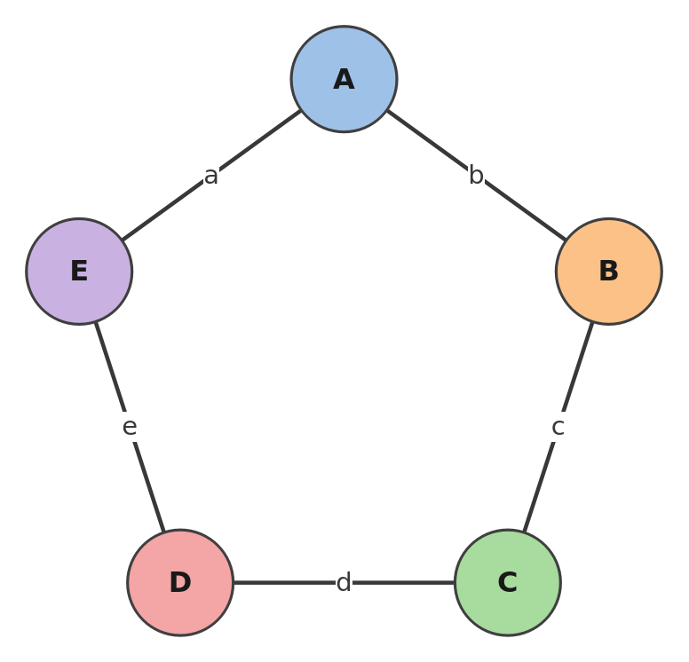
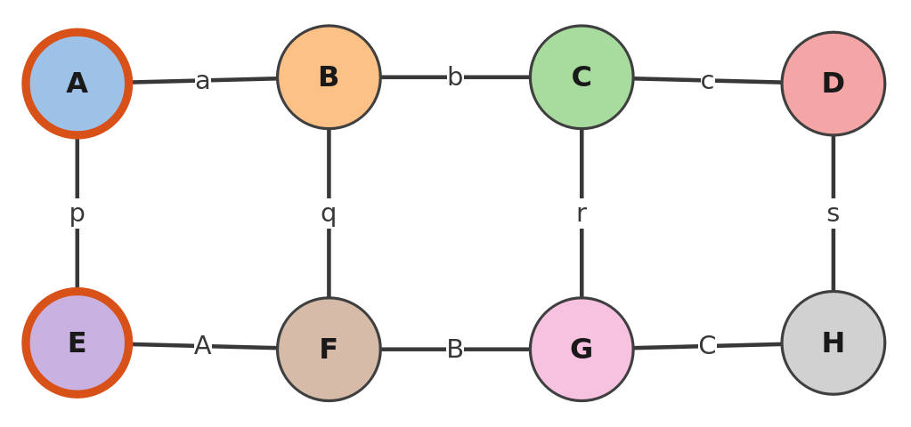
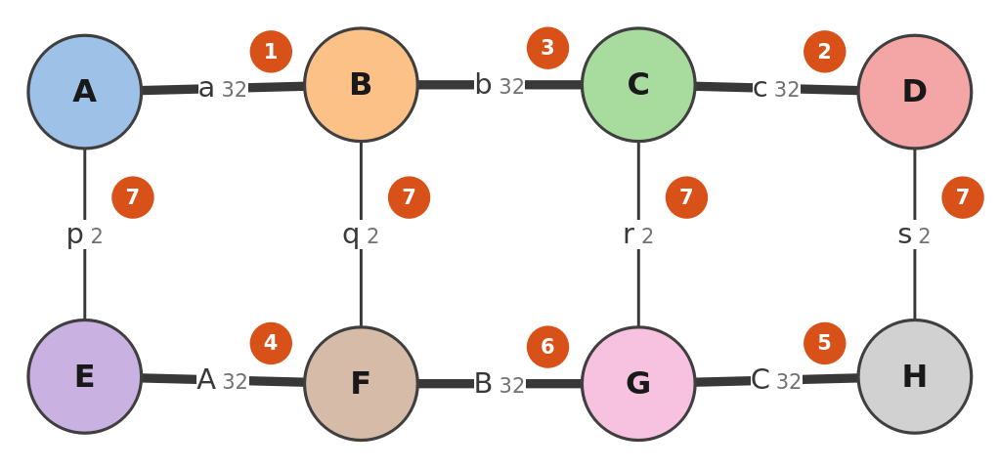
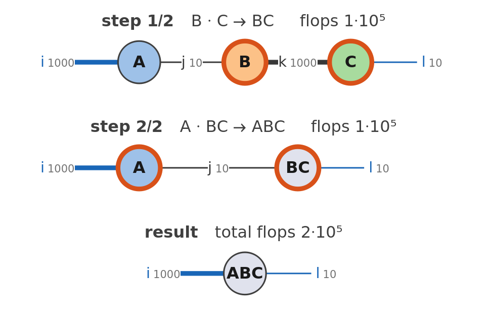

`EinsumDiagram` draws the tensor network of an einsum: the tensors are nodes, and each index is drawn by the number of
places it appears in. Options show the dimensions, the names of the tensors and the order of the contractions. Every
block on this page runs after

```mathematica
Needs["Summa`"]
```

## A first diagram

The product of two matrices: the tensors are named A, B, ... in order, the summed index `j` is a bond between them, and
the indices of the result, `i` and `k`, are open legs (blue).

```mathematica
EinsumDiagram["ij,jk->ik"]
```

<p align="center">ik: the tensors A and B joined by the bond j, with the open legs i on A and k on B"></p>

## How indices are drawn

Each index is drawn as a delta tensor with one leg for each time it appears, plus one if it is in the result:

- two legs make a line: a bond between two tensors, an open leg, or a loop on one tensor (a trace);
- one leg is an index summed in one tensor: a dashed leg ending in a small circle (a contraction with a vector of ones);
- three legs or more make a hyperedge: a purple dot joined to every tensor that has the index.

All of them in one network: `i` twice in A (a trace), `j` in A and B (a bond), `k` and `m` in the result (open legs),
`h` in B, C and D (a hyperedge), `x` in C only (a sum).

```mathematica
EinsumDiagram["iij,jkh,xh,mh->km"]
```

<p align="center">km: a loop i on A, the bond j between A and B, open legs k on B and m on D, the hyperedge h joining B, C and D, and the summed leg x on C ending in a small circle"></p>

A batch index is a hyperedge with an open leg: in `"bij,bjk->bik"`, `b` is in A, in B and in the result.

```mathematica
EinsumDiagram["bij,bjk->bik"]
```

<p align="center">bik: A and B joined by the bond j, with open legs i and k, and the hyperedge b joining A and B with an open leg b"></p>

In a notebook, hovering over a tensor or an index shows its indices, its dimension and its role.

## Dimensions

With the tensors, or their dimensions, the labels show the dimensions, and the lines are thicker for larger ones;
`"ShowDimensions" -> False` hides the numbers.

```mathematica
EinsumDiagram["ij,jk,kl->il", {{1000, 10}, {10, 1000}, {1000, 10}}]
```

<p align="center">il with dimensions: the open leg i and the bond k of dimension 1000 drawn thick, the bond j and the open leg l of dimension 10 drawn thin"></p>

## Names and colours

Tensors given as symbols are named after them:

```mathematica
rho = RandomReal[1, {4, 4}]; op = RandomReal[1, {4, 4}];
EinsumDiagram["ij,ji->", rho, op]
```

<p align="center"></p>

`"TensorNames"` names them by hand, and tensors with the same name have the same colour: the norm of a matrix-product
state, the state in the top row and its conjugate in the bottom one.

```mathematica
mps = "pa,aqb,brc,cs,pA,AqB,BrC,Cs->";
EinsumDiagram[mps, "TensorNames" -> {"A", "B", "B", "C", "A*", "B*", "B*", "C*"}]
```

<p align="center"></p>

## Layout

The automatic layout (classical multidimensional scaling of the distances in the network, refined by stress
majorisation) draws chains straight, rings round and grids as grids. `"Layout" -> "Circle"` puts the tensors on a
circle in their order, `"Line"` on a line, and a list of coordinates where you want them:

```mathematica
EinsumDiagram["ab,bc,cd,de,ea->", "Layout" -> "Circle"]
```

<p align="center"></p>

## Highlight

`"Highlight"` draws a thick border around the tensors at the positions given:

```mathematica
EinsumDiagram[mps, "Highlight" -> {1, 5}]
```

<p align="center"></p>

## The order of the contractions

`"ShowPath" -> True` writes on each index the step at which it is summed, in the order that Summa chooses for the
dimensions given (without them, every index has the dimension 8, the option `"DefaultDimension"`):

```mathematica
dims = {{2, 32}, {32, 2, 32}, {32, 2, 32}, {32, 2}, {2, 32}, {32, 2, 32}, {32, 2, 32}, {32, 2}};
EinsumDiagram[mps, dims, "ShowPath" -> True]
```

<p align="center"></p>

`"Steps" -> True` gives one picture for each step, the pair contracted next drawn with a thick border and each
intermediate at the centre of its tensors, and one of the result: `ListAnimate` plays them.

```mathematica
frames = EinsumDiagram["ij,jk,kl->il", {{1000, 10}, {10, 1000}, {1000, 10}}, "Steps" -> True];
GraphicsColumn[frames]
```

<p align="center"></p>

The option `"Path"` draws another order. The contraction tree of the order, with the cost of every step, is drawn by
`EinsumTree` ([Orders and costs](Orders-and-Costs#the-contraction-tree)); `EinsumFunction[...]["Diagram"]` and
`["Tree"]` draw those of a compiled einsum.
