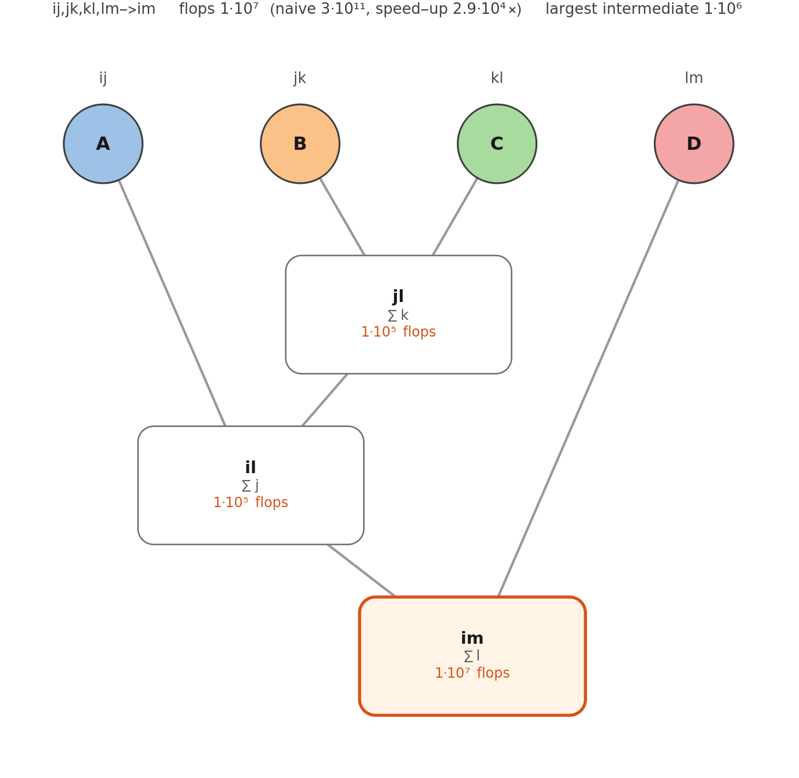
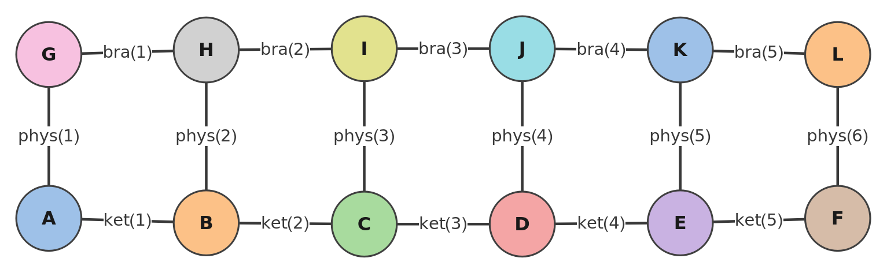

An einsum of several tensors is computed one pair of tensors at a time, and the order of the pairs decides the cost,
often by orders of magnitude. Summa chooses the order from the dimensions alone; `EinsumPath` shows it, with its cost.
Every block on this page runs after

```mathematica
Needs["Summa`"]
```

## Why the order matters

Three matrices $A$ (1000×10), $B$ (10×1000) and $C$ (1000×10): $(AB)C$ goes through a 1000×1000 intermediate,
$A(BC)$ through a 10×10 one. Summa takes $BC$ first:

```mathematica
chain = "ij,jk,kl->il"; dims = {{1000, 10}, {10, 1000}, {1000, 10}};
path = EinsumPath[chain, dims];
path["Contractions"] // Column
```

```text
jk,kl->jl
ij,jl->il
```

Its cost in flops, the cost of the naive sum (one loop over all the indices at once) and the speed-up:

```mathematica
Lookup[path, {"Flops", "NaiveFlops", "Speedup"}]
```

$$\\{200000.,2.\times 10^8,1000.\\}$$

A step costs the product of the dimensions of its indices, one multiplication and addition for each set of their
values: $BC$ costs $10\cdot1000\cdot10=10^5$. The naive sum costs the product of all the dimensions, once for each product of two
factors: $2\cdot10^8$ here.

## The keys of EinsumPath

`EinsumPath[spec, {dims1, dims2, ...}]` needs only the dimensions; `EinsumPath[spec, t1, t2, ...]` reads them from the
tensors.

| Key | |
|---|---|
| `"Spec"` | the einsum, with the implicit result written out |
| `"Path"` | the order, as pairs of positions ([below](#a-path-of-your-own)) |
| `"Method"` | how the order was found: `"Optimal"`, `"Greedy"`, `"Sequential"`, `"User"`, or `"Trivial"` for one or two tensors |
| `"Contractions"` | each step, as an einsum of two tensors |
| `"StepFlops"` | the cost of each step |
| `"Flops"` | the total cost, with the diagonals and sums taken within one tensor |
| `"NaiveFlops"` | the cost of the naive sum |
| `"Speedup"` | `"NaiveFlops"` divided by `"Flops"` |
| `"LargestIntermediate"` | the number of entries of the largest intermediate tensor, a measure of the memory needed |

```mathematica
Lookup[path, {"StepFlops", "LargestIntermediate"}]
```

```text
{{100000., 100000.}, 10000.}
```

## Choosing the order

The option `"Path"`, of `Einsum` and of `EinsumPath`, `EinsumFunction`, `EinsumDiagram` and `EinsumTree`, takes

- `Automatic` (the default): `"Optimal"` up to eight tensors, `"Greedy"` beyond;
- `"Optimal"`: an exact search, the order of least flops; up to fourteen tensors (beyond, it gives `Einsum::optbig` and
  uses `"Greedy"`);
- `"Greedy"`: at each step, among the pairs that share an index, the one whose result is smallest compared to the two
  tensors (as in opt_einsum);
- `"Sequential"`: from left to right;
- a list of pairs ([below](#a-path-of-your-own)).

```mathematica
Lookup[EinsumPath[chain, dims, "Path" -> #], "Flops"] & /@ {"Optimal", "Greedy", "Sequential"}
```

$$\\{200000.,200000.,2.\times 10^7\\}$$

The greedy order is often optimal, not always. In this network of seven tensors it costs four times as much:

```mathematica
net = "gi,ld,kji,hd,fba,kh,jef->";
netDims = {{3, 5}, {5, 8}, {20, 5, 5}, {8, 8}, {5, 3, 5}, {20, 8}, {5, 5, 5}};
Lookup[EinsumPath[net, netDims, "Path" -> #], "Flops"] & /@ {"Optimal", "Greedy", "Sequential"}
```

$$\\{1034.,4589.,18720.\\}$$

## A path of your own

A path is a list of pairs, in the format of numpy's `einsum_path` but counted from 1: each pair names two tensors by
their positions in the current list; both are removed, and their result is appended at the end. For the chain,
`{{2, 3}, {1, 2}}` contracts $B$ with $C$, then $A$ with $BC$, and `{{1, 2}, {1, 2}}` is $(AB)C$:

```mathematica
EinsumPath[chain, dims, "Path" -> {{1, 2}, {1, 2}}]["Flops"]
```

$$2.\times 10^7$$

The order changes the cost, not the result:

```mathematica
SeedRandom[1]; {ta, tb, tc} = RandomReal[1, #] & /@ dims;
Einsum[chain, ta, tb, tc, "Path" -> {{1, 2}, {1, 2}}] == Einsum[chain, ta, tb, tc]
```

```text
True
```

A path from numpy, `[(1, 2), (0, 1)]`, is `{{2, 3}, {1, 2}}` here. A path must contract everything, `n - 1` pairs for
`n` tensors (`Einsum::path` otherwise).

## The contraction tree

`EinsumTree` draws the order: each box is an intermediate tensor, with its indices, what the step does (`∑` the indices
it sums, `∘` a batch product, `⊗` an outer product) and its flops; the title gives the totals. Four matrices:

```mathematica
EinsumTree["ij,jk,kl,lm->im", {{1000, 10}, {10, 1000}, {1000, 10}, {10, 1000}}]
```

<p align="center">im: B and C first (summing k), then A (summing j), then D (summing l), with 10^5, 10^5 and 10^7 flops"></p>

Without dimensions, `EinsumTree[spec]` gives every index the dimension 8 (the option `"DefaultDimension"`) and shows no
flops. `EinsumFunction[...]["Tree"]` is the tree of a compiled einsum.

## Large networks

The exact search grows as $3^n$ with the number $n$ of tensors, which is why `Automatic` turns to the greedy search
beyond eight. `"Optimal"` pays when the contraction takes much longer than the search, or is done many times
(`EinsumFunction` plans once: [Speed](Speed#einsumfunction-in-loops)). The norm of a matrix-product state of six sites,
twelve tensors, with labels made by code:

```mathematica
chainOf[l_, bond_] := Table[Join[If[i > 1, {bond[i - 1]}, {}], {phys[i]}, If[i < l, {bond[i]}, {}]], {i, l}];
norm6 = Join[chainOf[6, ket], chainOf[6, bra]] -> {};
EinsumDiagram[norm6]
```

<p align="center"></p>

With bonds of dimension 32, the greedy order costs $5\cdot10^4$ flops, $10^{13}$ times less than the naive sum:

```mathematica
dims6 = Map[If[Head[#] === phys, 2, 32] &, First[norm6], {2}];
Lookup[EinsumPath[norm6, dims6], {"Method", "Flops", "Speedup"}]
```

$$\\{\text{Greedy},53312.,1.48678\times 10^{13}\\}$$

and the exact search, over all the subsets of the twelve tensors, finds no better order:

```mathematica
EinsumPath[norm6, dims6, "Path" -> "Optimal"]["Flops"]
```

$$53312.$$