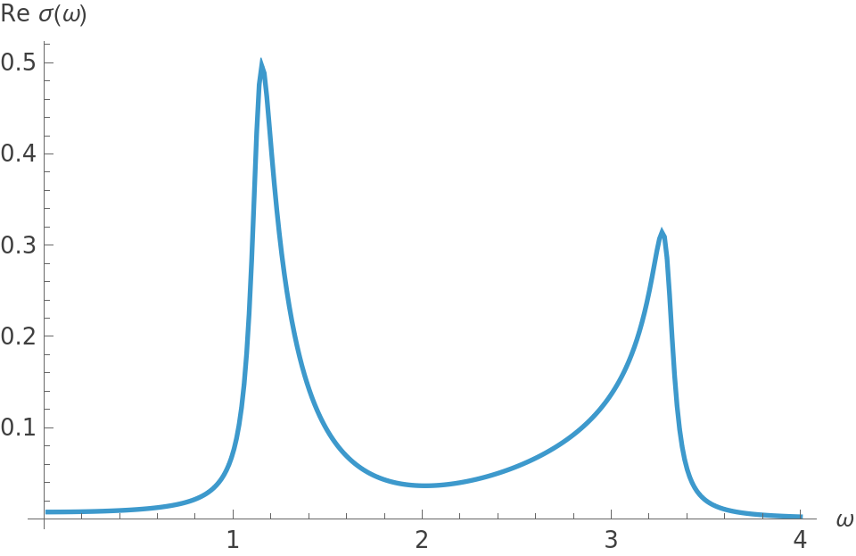
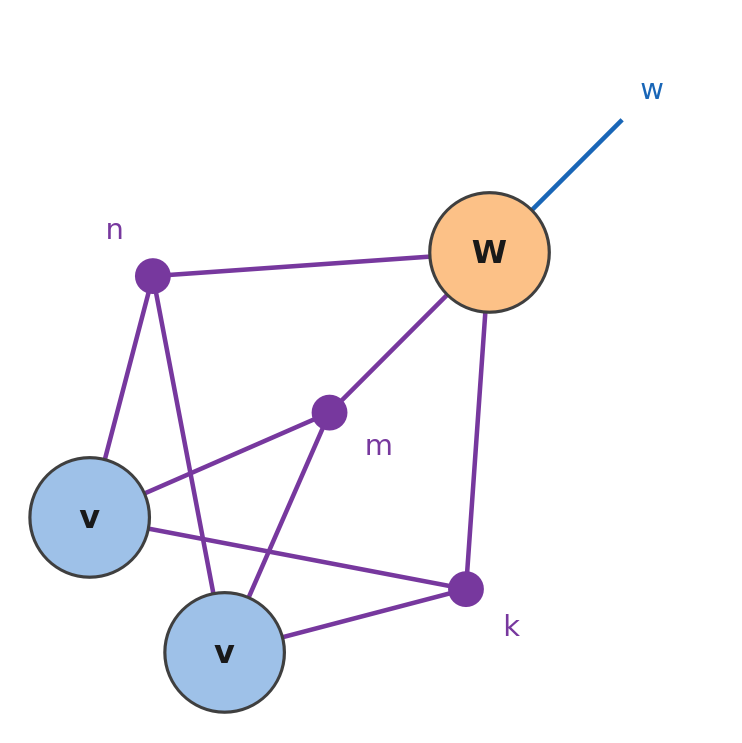
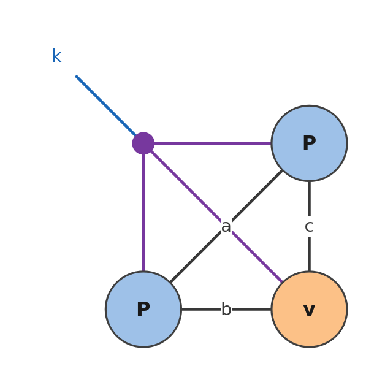

Three formulas of physics, each written as one einsum, with the indices of the formula: the optical conductivity of
a two-band chain by the Kubo formula, a trace at every momentum, and the norm of a matrix-product state. Summa finds
how to compute them. Every block on this page runs after

```mathematica
Needs["Summa`"]
```

## A two-band chain

The Rice–Mele chain has two orbitals in each cell, and the Bloch Hamiltonian

$$H(k)=(1+0.6\cos k)\thinspace\sigma_x+0.6\sin k\thinspace\sigma_y+0.4\thinspace\sigma_z,$$

with the velocity $v(k)=\partial_kH(k)$; here on 400 momenta, with $e=\hbar=1$ and the lattice constant 1.

```mathematica
nk = 400; ks = 2. Pi Range[0, nk - 1]/nk;
h = Table[(1 + 0.6 Cos[k]) PauliMatrix[1] + 0.6 Sin[k] PauliMatrix[2] + 0.4 PauliMatrix[3], {k, ks}];
v = Table[-0.6 Sin[k] PauliMatrix[1] + 0.6 Cos[k] PauliMatrix[2], {k, ks}];
```

The energies `e[[k, n]]` and the eigenvectors `u[[k, n]]`, the lower band first; the gap between the bands goes from
1.13 to 3.30:

```mathematica
bands[hk_] := Module[{vals, vecs}, {vals, vecs} = Eigensystem[hk]; {vals[[#]], vecs[[#]]} &[Ordering[vals]]];
{e, u} = Transpose[bands /@ h];
MinMax[e[[All, 2]] - e[[All, 1]]]
```

```text
{1.13137, 3.29848}
```

## The velocity between the bands

$v_{nm}(k)=\langle u_{kn}|v(k)|u_{km}\rangle=\sum_{ab}u_{kna}^{\ast}v_{kab}u_{kmb}$ is a product of three tensors that
all have the index `k`:

```mathematica
vb = Einsum["kna,kab,kmb->knm", Conjugate[u], v, u];
Dimensions[vb]
```

```text
{400, 2, 2}
```

## The Kubo formula

At zero temperature, with the lower band filled ($f_1=1$, $f_2=0$), the absorptive part of the optical conductivity is

$$\mathrm{Re}\thinspace\sigma(\omega)=\frac{\pi}{N\omega}\sum_{k,n,m}(f_n-f_m)\thinspace v_{nm}(k)\thinspace v_{mn}(k)\thinspace\delta\big(\omega-E_m(k)+E_n(k)\big).$$

Everything but the two velocities makes one array, with the delta function broadened into a Lorentzian of width
$\eta=0.05$, $\pi\delta(x)\to\eta/(x^2+\eta^2)$:

$$W_{knm}(\omega)=\frac{(f_n-f_m)\thinspace\eta}{N\omega\thinspace[(\omega-E_m(k)+E_n(k))^2+\eta^2]}.$$

```mathematica
f = {1., 0.}; eta = 0.05; omegas = Subdivide[0.02, 4., 299];
w = Table[(f[[n]] - f[[m]]) eta/(nk om ((om - e[[k, m]] + e[[k, n]])^2 + eta^2)), {k, nk}, {n, 2}, {m, 2}, {om, omegas}];
```

and the formula is one einsum, with the indices of the formula: `k`, `n` and `m` are each in three tensors.

```mathematica
sigma = Re[Einsum["knm,kmn,knmw->w", vb, vb, w]];
ListLinePlot[Transpose[{omegas, sigma}], AxesLabel -> {"ω", "Re σ(ω)"}, PlotRange -> All]
```

<p align="center"></p>

The light is absorbed between the smallest and the largest gap, with a peak at each edge, where the gap
$E_2(k)-E_1(k)$ is flat. The explicit sum, on three frequencies:

```mathematica
direct[j_] := Re[Sum[vb[[k, n, m]] vb[[k, m, n]] w[[k, n, m, j]], {k, nk}, {n, 2}, {m, 2}]];
Max[Abs[sigma[[{1, 150, 300}]] - direct /@ {1, 150, 300}]] < 10^-12
```

```text
True
```

Summa first multiplies the two velocities element by element (the second one transposed), then sums `k`, `n` and `m`
at once against `w`, in one product of a vector and a matrix:

```mathematica
EinsumPath["knm,kmn,knmw->w", vb, vb, w]["Contractions"] // Column
```

```text
knm,kmn->knm
knm,knmw->w
```

In the network, the three indices are hyperedges:

```mathematica
EinsumDiagram["knm,kmn,knmw->w", "TensorNames" -> {"v", "v", "W"}]
```

<p align="center">w: the tensors v, v and W joined by the three hyperedges k, n and m, with the open leg w on W"></p>

## A trace at every momentum

With $P(k)$ the projector on the lower band, $\mathrm{Tr}[P(k)v(k)P(k)]$ is the velocity of that band,
$\partial_kE_1(k)$ (the Hellmann–Feynman theorem). The projector is an outer product for every `k`, and the trace a
loop of three matrices for every `k`:

```mathematica
p = Einsum["ka,kb->kab", u[[All, 1]], Conjugate[u[[All, 1]]]];
velocity = Re[Einsum["kab,kbc,kca->k", p, v, p]];
```

The lower band is $E_1(k)=-|d(k)|$, with $d(k)$ the vector of the three coefficients of $H(k)$, so
$\partial_kE_1(k)=0.6\sin k/|d(k)|$:

```mathematica
Max[Abs[velocity - 0.6 Sin[ks]/Sqrt[(1 + 0.6 Cos[ks])^2 + (0.6 Sin[ks])^2 + 0.16]]] < 10^-12
```

```text
True
```

```mathematica
EinsumDiagram["kab,kbc,kca->k", "TensorNames" -> {"P", "v", "P"}]
```

<p align="center">k: the tensors P, v and P joined in a loop by the bonds a, b and c, and by the hyperedge k, which has an open leg"></p>

## The norm of a matrix-product state

A state of four sites, $\psi_{pqrs}=\sum A_{a}^{p}B_{ab}^{q}C_{bc}^{r}D_{c}^{s}$, with bonds of dimension 32; its norm
joins the state (indices `a`, `b`, `c`) and its conjugate (indices `A`, `B`, `C`) along the physical indices `p`, `q`,
`r`, `s`:

```mathematica
mps = "pa,aqb,brc,cs,pA,AqB,BrC,Cs->";
SeedRandom[4]; psi = {RandomReal[1, {2, 32}], RandomReal[1, {32, 2, 32}], RandomReal[1, {32, 2, 32}], RandomReal[1, {32, 2}]};
norm = Einsum[mps, Sequence @@ psi, Sequence @@ psi];
```

The same against the 16 amplitudes of the state, themselves an einsum:

```mathematica
amplitudes = Flatten[Einsum["pa,aqb,brc,cs->pqrs", Sequence @@ psi]];
Abs[norm - amplitudes . amplitudes] < 10^-12 norm
```

```text
True
```

Summa contracts each half of the network from its two ends, and joins the halves at the end:

```mathematica
EinsumPath[mps, Sequence @@ psi, Sequence @@ psi]["Contractions"] // Column
```

```text
pa,aqb->pqb
brc,cs->brs
pqb,brs->pqrs
pA,AqB->pqB
BrC,Cs->Brs
pqB,Brs->pqrs
pqrs,pqrs->
```

The overlap $\langle\phi|\psi\rangle$ of two states is the same einsum, with the conjugate tensors of $\phi$ in place
of one copy of those of $\psi$:

```mathematica
SeedRandom[5]; phi = Map[RandomComplex[{-1 - I, 1 + I}, Dimensions[#]] &, psi];
overlap = Einsum[mps, Sequence @@ Conjugate[phi], Sequence @@ psi];
Abs[overlap - Conjugate[Flatten[Einsum["pa,aqb,brc,cs->pqrs", Sequence @@ phi]]] . amplitudes] < 10^-12 Abs[overlap]
```

```text
True
```