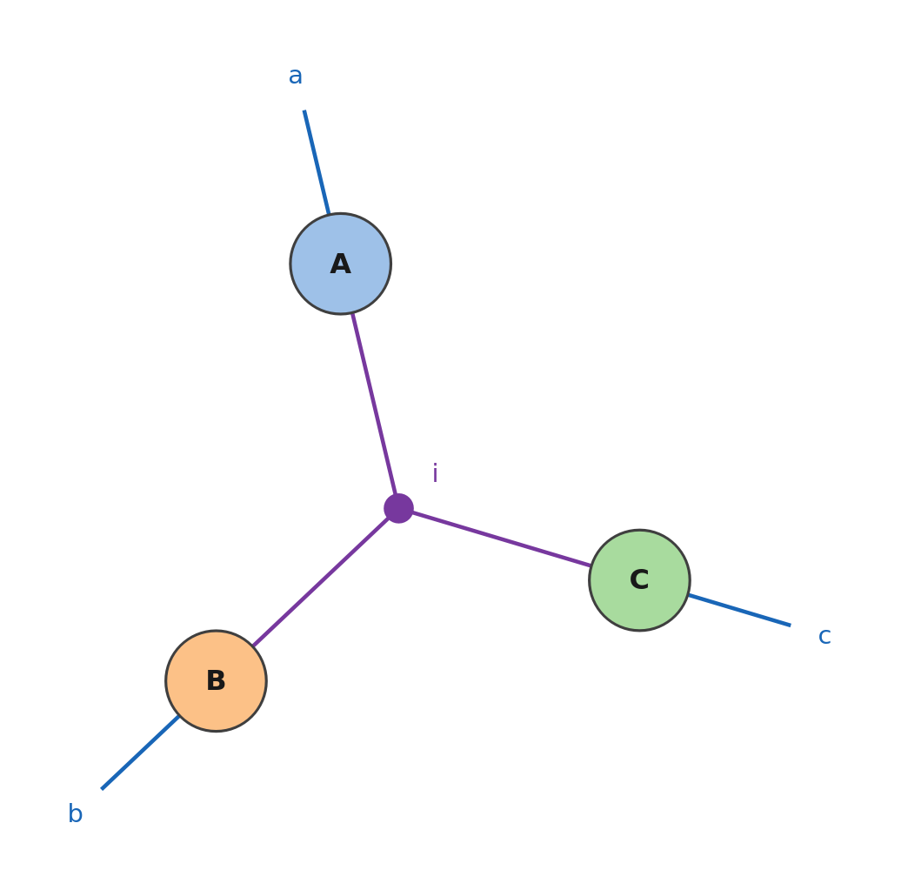

In numpy and in Summa an index can appear any number of times: twice in one tensor (a diagonal, a trace), once (a sum),
in two tensors (a bond), or in three tensors and more (a hyperedge, a batch index). Indices repeated more than twice are
the reason Summa exists: you write the formula, and the package finds how to compute it. Every block on this page runs
after

```mathematica
Needs["Summa`"]
```

## Within one tensor: diagonals and traces

An index repeated in one tensor takes its diagonal; summed, the trace:

```mathematica
m = {{a, b}, {c, d}};
{Einsum["ii->i", m], Einsum["ii->", m]}
```

$$\\{\\{a,d\\},a+d\\}$$

At any rank, and in any number of its levels: the diagonal of a tensor of rank three, and the trace over its first two
indices:

```mathematica
t = Array[x, {2, 2, 2}];
Einsum["iii->i", t]
```

```text
{x[1, 1, 1], x[2, 2, 2]}
```

```mathematica
Einsum["iij->j", t]
```

```text
{x[1, 1, 1] + x[2, 2, 1], x[1, 1, 2] + x[2, 2, 2]}
```

## Sums

An index in one tensor only, and not in the result, is summed: the sums of the rows, of the columns, of everything.

```mathematica
{Einsum["ij->i", m], Einsum["ij->j", m], Einsum["ij->", m]}
```

$$\\{\\{a+b,c+d\\},\\{a+c,b+d\\},a+b+c+d\\}$$

## In two tensors

An index in two tensors is summed if it does not reach the result, and kept otherwise: the scalar product of two
matrices, and the scalar products of their rows.

```mathematica
n = {{p, q}, {r, s}};
{Einsum["ij,ij->", m, n], Einsum["ij,ij->i", m, n]}
```

$$\\{a p+b q+c r+d s,\\{a p+b q,c r+d s\\}\\}$$

## In three tensors and more

An index can be shared by any number of tensors, here three vectors, $\sum_i x_iy_iz_i$:

```mathematica
Einsum["i,i,i->", {a, b}, {c, d}, {e, f}]
```

$$a c e+b d f$$

and, kept in the result, their product element by element:

```mathematica
Einsum["i,i,i->i", {a, b}, {c, d}, {e, f}]
```

$$\\{a c e,b d f\\}$$

In a drawing of the network such an index is a hyperedge, a dot joined to all the tensors that share it
([Diagrams](Diagrams#how-indices-are-drawn)).

## Batch indices

An index in two tensors and in the result is a batch index: one contraction for each of its values. A thousand products
of 3×3 matrices:

```mathematica
SeedRandom[1]; {x1, x2} = RandomReal[1, {2, 1000, 3, 3}];
Einsum["bij,bjk->bik", x1, x2] == MapThread[Dot, {x1, x2}]
```

```text
True
```

and a quadratic form for every row of a matrix, $\sum_{ij}r_{bi}g_{ij}r_{bj}$:

```mathematica
SeedRandom[2]; {rows, g} = {RandomReal[1, {1000, 3}], RandomReal[1, {3, 3}]};
Einsum["bi,ij,bj->b", rows, g, rows] == (# . g . # & /@ rows)
```

```text
True
```

## The CP decomposition

A tensor of rank three in its canonical (CP) decomposition, $T_{abc}=\sum_i U_{ai}V_{bi}W_{ci}$, is one einsum, in which
`i` joins three matrices:

```mathematica
SeedRandom[3]; {u, v, w} = RandomReal[1, {3, 4, 2}];
Einsum["ai,bi,ci->abc", u, v, w] == Table[Sum[u[[a, i]] v[[b, i]] w[[c, i]], {i, 2}], {a, 4}, {b, 4}, {c, 4}]
```

```text
True
```

```mathematica
EinsumDiagram["ai,bi,ci->abc"]
```

<p align="center">abc: three tensors A, B, C, each with an open leg a, b, c, joined by the hyperedge i, drawn as a purple dot"></p>

`EinsumPath` shows how it is computed, for matrices of 40×8:

```mathematica
EinsumPath["ai,bi,ci->abc", {{40, 8}, {40, 8}, {40, 8}}]["Contractions"] // Column
```

```text
ai,ci->iac
iac,bi->bac
```

First `u` and `w` are joined for every value of `i` (a product batched over `i`, which `v` still needs), then the
product with `v` sums `i`, and a transpose puts the result in the order `abc`: the hyperedge is a batch index in the
first step, a summed index in the last.

## Without Summa

`TensorContract` can sum over three slots and more, on the outer product of the tensors:

```mathematica
{Einsum["i,i,i->", {a, b}, {c, d}, {e, f}], TensorContract[TensorProduct[{a, b}, {c, d}, {e, f}], {{1, 2, 3}}]}
```

$$\\{a c e+b d f,a c e+b d f\\}$$

but it builds the whole outer product first: for `"ai,bi,ci->abc"` with three 40×8 matrices that is
$40\cdot8\cdot40\cdot8\cdot40\cdot8\approx3.3\cdot10^7$ numbers, 262 MB, and it took 0.37 s against 1.6 ms for `Einsum`
(Mathematica 15, one machine). It cannot keep a shared index in the result, as a batch index. The resource function
`EinsteinSummation` refuses an index that appears three times (`{{i}, {i}, {i}} -> {}`) and a batch index kept in the
result (`{{k, a, b}, {k, b, c}} -> {k, a, c}`).

An index cannot appear twice in the result (`"i->ii"` gives `Einsum::outrep`, as in numpy): to put a vector on a
diagonal, see the [FAQ](FAQ#can-an-index-appear-twice-in-the-result).